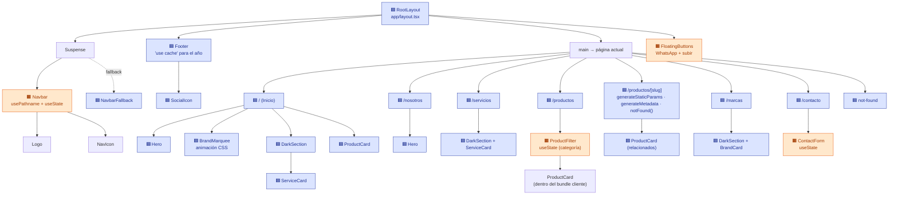

# IKOMI PERÚ — Sitio corporativo con Next.js

Réplica académica del sitio web de **IKOMI PERÚ S.R.L.** (importadora de repuestos de Korea y Japón), hecha con **Next.js 16 (App Router)**, **TypeScript** y **Tailwind CSS v4**.

> **Alumno:** Angel Moza Cabanillas · **Curso:** Desarrollo de Aplicaciones Web Avanzado (Tecsup) · **Docente:** Jorge Ventura Gonzales

- 🌐 **Demo en Render:** `https://ikomi-next-moza.onrender.com` *(actualizar con la URL real después del despliegue)*
- 📄 Decisiones técnicas: [DECISIONES.md](./DECISIONES.md)
- 🤖 Bitácora de uso de IA: [BITACORA_IA.md](./BITACORA_IA.md)
- 📸 Capturas (build, Network y responsive): [evidencias/](./evidencias)

---

## Requisitos

| Herramienta | Versión |
|---|---|
| Node.js | **20.9 o superior** (probado con Node 22 y 24) |
| npm | 10 o superior |
| Git | cualquiera reciente |

Comprueba tus versiones con:

```bash
node -v
npm -v
```

## Instalación y ejecución

```bash
# 1. Clonar el repositorio
git clone https://github.com/<tu-usuario>/ikomi-next-moza.git
cd ikomi-next-moza

# 2. Instalar dependencias
npm install

# 3. Levantar el servidor de desarrollo
npm run dev
```

Abre **http://localhost:3000** en el navegador.

### Compilar para producción

```bash
npm run build   # compila y prerenderiza todas las páginas
npm run start   # sirve el build en http://localhost:3000
```

### Revisar el código

```bash
npm run lint
```

## Despliegue en Render

1. Sube el repositorio a GitHub.
2. En [render.com](https://render.com) elige **New → Blueprint** y selecciona el repositorio. Render lee `render.yaml` automáticamente.
   - Si prefieres hacerlo manualmente, usa **New → Web Service** con:
     - **Build Command:** `npm ci && npm run build`
     - **Start Command:** `npm run start`
     - **Environment:** `NODE_VERSION = 22.12.0`
3. Espera a que termine el build y abre la URL `https://<nombre>.onrender.com`.

> En el plan gratuito el servicio se duerme tras 15 minutos sin visitas, así que la primera carga puede tardar unos segundos.

---

## Rutas

| Página | URL | Archivo |
|---|---|---|
| Inicio | `/` | `app/page.tsx` |
| Nosotros | `/nosotros` | `app/nosotros/page.tsx` |
| Servicios | `/servicios` | `app/servicios/page.tsx` |
| Productos | `/productos` | `app/productos/page.tsx` |
| Detalle de producto | `/productos/[slug]` | `app/productos/[slug]/page.tsx` |
| Marcas | `/marcas` | `app/marcas/page.tsx` |
| Contáctenos | `/contacto` | `app/contacto/page.tsx` |
| 404 | cualquier ruta inexistente | `app/not-found.tsx` |

Productos disponibles: `disco-de-embrague`, `corona-y-pinon`, `plato-de-embrague`, `pastillas-de-freno`, `eje-de-caja`, `volante-bimasa`. Por ejemplo: `/productos/corona-y-pinon`.

## Estructura del proyecto

```
ikomi-next-moza/
├── app/                      # App Router: cada carpeta con page.tsx es una ruta
│   ├── layout.tsx            # Layout raíz: Navbar + Footer + fuentes + metadata
│   ├── page.tsx              # Inicio (/)
│   ├── globals.css           # Tailwind + tema (colores y fuentes definidos una vez)
│   ├── not-found.tsx         # 404 personalizada
│   ├── icon.svg              # Favicon
│   ├── fonts/                # Raleway y Open Sans (next/font/local)
│   ├── nosotros/page.tsx
│   ├── servicios/page.tsx
│   ├── productos/
│   │   ├── page.tsx          # Listado con filtro
│   │   └── [slug]/page.tsx   # Detalle (ruta dinámica)
│   ├── marcas/page.tsx
│   └── contacto/page.tsx
├── components/               # Componentes reutilizables
├── data/                     # productos.ts, marcas.ts, servicios.ts, site.ts
├── public/images/            # Imágenes de productos, empresa y hero
├── evidencias/               # Capturas solicitadas
├── DECISIONES.md
├── BITACORA_IA.md
├── render.yaml               # Configuración de despliegue en Render
└── next.config.ts
```

## Árbol de componentes

🟦 **Server Component** (se renderiza en el servidor, no envía JS al navegador) · 🟧 **Client Component** (`"use client"`, se hidrata en el navegador)



> Nota: `Logo`, `NavIcon` y `ProductCard` no tienen `"use client"`. Cuando los importa un Client Component (Navbar o ProductFilter), pasan a formar parte del bundle del cliente. Cuando los usa un Server Component (Footer o la página de detalle), se renderizan solo en el servidor.

## Tecnologías

- [Next.js 16](https://nextjs.org) (App Router, Server Components, `cacheComponents`)
- React 19 + TypeScript
- Tailwind CSS v4 (tema en `@theme`)
- `next/image`, `next/font/local`
- [lucide-react](https://lucide.dev) (íconos) y [simple-icons](https://simpleicons.org) (íconos de redes sociales)

## Imágenes

Las imágenes de `public/images/` son **ilustraciones provisionales** con la misma proporción que las del sitio original. Para usar las fotos reales de IKOMI basta con reemplazar cada archivo **con el mismo nombre** (por ejemplo `public/images/productos/disco-de-embrague.png`). No hay que tocar el código.

---

*Proyecto académico sin fines comerciales. IKOMI PERÚ y las marcas mencionadas pertenecen a sus respectivos dueños.*
